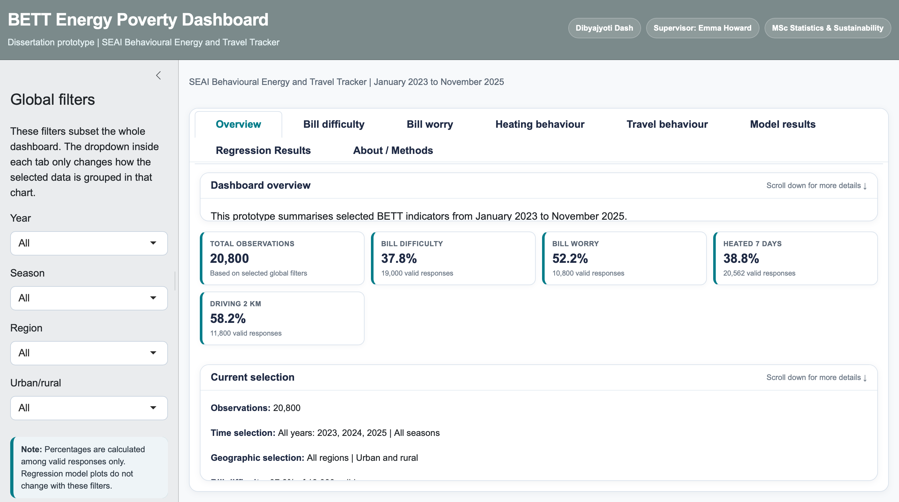

# BETT Energy Poverty Dashboard

An interactive **R Shiny dashboard** exploring energy poverty, financial stress, household heating behaviour and travel-related energy perceptions in Ireland using the Sustainable Energy Authority of Ireland (SEAI) **Behavioural Energy and Travel Tracker (BETT)**.

This project was developed as part of my **MSc in Sustainability and Statistics at Trinity College Dublin**.

## Live dashboard

**[Open the interactive dashboard](https://egs19j-dibyajyoti-dash.shinyapps.io/bett-energy-poverty-dashboard-v83/)**



## Project highlights

- Analyses SEAI Behavioural Energy and Travel Tracker data from 2023–2025
- Explores energy bill difficulty, bill worry, heating behaviour and travel-related energy perceptions
- Uses descriptive statistics and binary logistic regression
- Includes interactive filtering by income, tenure, region, age and dwelling characteristics
- Developed in R using Shiny, ggplot2 and dplyr

## Project overview

The project extends analysis of the BETT survey across **January 2023 to November 2025**. It combines descriptive analysis, binary logistic regression and interactive visualisation to explore how energy-related outcomes vary over time and across household characteristics.

The dashboard focuses on four outcomes:

- difficulty paying energy bills;
- worry about energy bills;
- heating the home seven days per week; and
- perceived energy intensity of driving 2 km in a petrol/diesel car rather than walking.

Users can explore results across characteristics including year, season, income group, housing tenure, region and urban/rural location.

## Key findings

The dissertation analysis found that reported difficulty paying energy bills declined over the study period, from **41.0% in 2023** to **34.1% in 2024** and **32.6% in 2025** among valid responses.

Income and housing tenure showed particularly strong associations with bill difficulty in the adjusted model. Compared with respondents in the highest-income group, those with monthly household income below €1,500 had **7.71 times the adjusted odds** of reporting bill difficulty. Local-authority or housing-association renters had **3.29 times the adjusted odds** compared with outright homeowners.

The regression models are interpreted as **explanatory rather than predictive**.

## Methods

The analytical workflow included:

- data cleaning and recoding in R;
- descriptive statistics;
- binary logistic regression;
- odds ratios and 95% confidence intervals;
- model diagnostics and interaction testing; and
- interactive dashboard development with R Shiny.

## Technology

- **R**
- **Shiny**
- **bslib**
- **ggplot2**
- **data.table**
- **shinyapps.io** for deployment

## Repository structure

```text
BETT-Energy-Poverty-Dashboard/
├── app/
│   └── app.R
├── outputs/
│   ├── README.md
│   └── graphs/
│       ├── odds_ratio_plot_bill_difficulty.png
│       ├── odds_ratio_plot_bill_worry.png
│       ├── odds_ratio_plot_heating_7days_no_season.png
│       └── odds_ratio_plot_drive2k_clean.png
├── .gitignore
└── README.md
```

## Data availability

The full/raw SEAI BETT dataset and the larger cleaned analytical dataset are **not included in this repository**.

The live dashboard uses a lightweight dataset derived from BETT. The underlying survey-derived dataset is not redistributed here while the relevant data-access and redistribution conditions are respected. See [`outputs/README.md`](outputs/README.md) for the fields expected by the application.

As a result, the public repository is intended primarily to document the **application code, methodology and visual outputs**. Users with authorised access to the required prepared data can run the application locally.

## Running locally

1. Clone or download this repository.
2. Install the required R packages:

```r
install.packages(c("shiny", "bslib", "ggplot2", "data.table"))
```

3. Place an authorised copy of `bett_dashboard_small.csv` inside the `outputs/` directory.
4. Open the `app` directory in R/RStudio.
5. Run:

```r
shiny::runApp()
```

## About the project

**Author:** Dibyajyoti Dash  
**Programme:** MSc Sustainability and Statistics, Trinity College Dublin  
**Supervisor:** Dr Emma Howard  
**Year:** 2026

The dashboard was developed to make selected statistical findings easier to explore interactively while keeping the full model specifications and diagnostics within the dissertation.

## Acknowledgement

The project uses data from the **Sustainable Energy Authority of Ireland (SEAI) Behavioural Energy and Travel Tracker (BETT)**. The analysis, interpretation and dashboard development are the author's own academic work.
